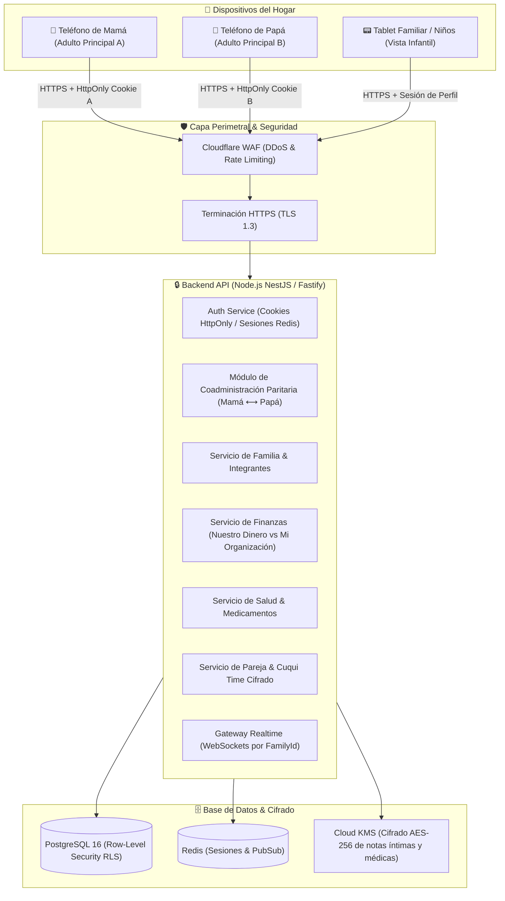
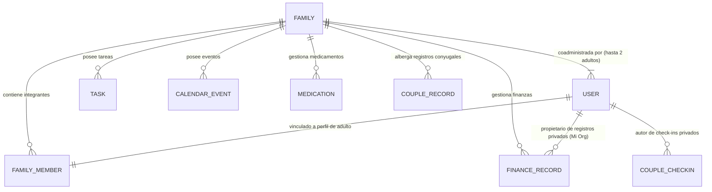

# 🏛️ ARQUITECTURA DE PRODUCCIÓN MULTIUSUARIO: "NUESTRO HOGAR"
## Especificación Técnica Integral: Coadministración Paritaria de Adultos Principales y Privacidad Familiar

> **Proyecto:** Nuestro Hogar (Plataforma de Organización Familiar)  
> **Filosofía Fundamental del Producto:** Nuestro Hogar representa una familia construida conjuntamente por dos adultos (Mamá y Papá). No existe jerarquía de "Propietario e Invitado" ni "Cónyuge Secundario". Mamá y Papá son ambos **Adultos Principales (`ADULT_PRIMARY`)** con igualdad de derechos, coadministración compartida del hogar y estricta privacidad individual.

---

## 1. Arquitectura de Coadministración Paritaria

### 1.1 Modelo Conceptual del Hogar

```
        MAMÁ (Adulto Principal) ⟷ PAPÁ (Adulto Principal)
                       ╲               ╱
                        FAMILY (Hogar)
                       ╱       │       ╲
                     Annie   Derek    Axel
                    (Hija)   (Hijo)  (Bebé)
```

- **Mismo Nivel Jerárquico:** Mamá y Papá son coadministradores de la misma `Family` y comparten el mismo `family_id`.
- **Cuentas y Sesiones Independientes:** Cada adulto cuenta con sus propias credenciales (correo electrónico y contraseña independientes) y sesiones seguras en sus dispositivos personales.
- **Doble Dimensión (Compartido vs. Privado):**
  - **Dimensión Familiar (❤️ Compartido):** Tareas, calendario, finanzas familiares ("Nuestro Dinero"), salud de los niños, acuerdos y momentos de pareja (incluyendo Cuqui Time entre ambos adultos).
  - **Dimensión Personal (🔒 Privado):** Finanzas personales ("Mi Organización"), check-ins personales privados y borradores conyugales para reflexión individual. Ningún adulto puede acceder a los datos privados del otro salvo consentimiento explícito.
- **Hijos (`CHILD`):** Perfiles dependientes sin privilegios administrativos, con acceso exclusivo a su entorno formativo lúdico (hábitos infantiles, recompensas y reset familiar).

---

## 2. Diagrama de Arquitectura Cliente-Servidor (Zero-Trust)



---

## 3. Base de Datos: Esquema Relacional de Coadministración

Se modela explícitamente que una familia cuenta con hasta dos adultos principales sin relación de subordinación.



---

## 4. Modelos de Datos en PostgreSQL

### 4.1 Tabla `families`
Representa el hogar. No existe un `owner_user_id` único; la familia pertenece a sus adultos principales.

```sql
CREATE TABLE families (
    id UUID PRIMARY KEY DEFAULT gen_random_uuid(),
    name VARCHAR(100) NOT NULL, -- Ej: "Familia González Pérez"
    settings JSONB NOT NULL DEFAULT '{}'::jsonb,
    -- Token temporal para vincular al segundo adulto principal (se nulifica una vez vinculado)
    co_admin_linking_token VARCHAR(64) UNIQUE,
    co_admin_linking_expires_at TIMESTAMPTZ,
    created_at TIMESTAMPTZ NOT NULL DEFAULT NOW(),
    updated_at TIMESTAMPTZ NOT NULL DEFAULT NOW()
);
```

### 4.2 Tabla `users`
Cuentas de autenticación de los adultos. Ambos adultos comparten la misma categoría paritaria `FAMILY_ADULT`.

```sql
CREATE TABLE users (
    id UUID PRIMARY KEY DEFAULT gen_random_uuid(),
    family_id UUID NOT NULL REFERENCES families(id) ON DELETE CASCADE,
    email VARCHAR(255) UNIQUE NOT NULL,
    password_hash VARCHAR(255) NOT NULL,
    role VARCHAR(50) NOT NULL DEFAULT 'FAMILY_ADULT' CHECK (role IN ('FAMILY_ADULT', 'SUPER_ADMIN')),
    is_active BOOLEAN NOT NULL DEFAULT TRUE,
    pin_hash VARCHAR(255), -- PIN opcional de 4-6 dígitos para cambio ágil en tablet compartida
    last_login_at TIMESTAMPTZ,
    created_at TIMESTAMPTZ NOT NULL DEFAULT NOW(),
    updated_at TIMESTAMPTZ NOT NULL DEFAULT NOW()
);

CREATE INDEX idx_users_family_id ON users(family_id);
CREATE INDEX idx_users_email ON users(email);
```

### 4.3 Tabla `family_members`
Integrantes de la familia (adultos principales e hijos).

```sql
CREATE TABLE family_members (
    id UUID PRIMARY KEY DEFAULT gen_random_uuid(),
    family_id UUID NOT NULL REFERENCES families(id) ON DELETE CASCADE,
    user_id UUID REFERENCES users(id) ON DELETE SET NULL, -- Vinculado a User si es adulto principal; NULL si es niño
    name VARCHAR(100) NOT NULL,
    role VARCHAR(20) NOT NULL CHECK (role IN ('adult', 'child')),
    relationship VARCHAR(30) NOT NULL CHECK (relationship IN ('mama', 'papa', 'hija', 'hijo', 'bebe', 'otro')),
    age INT,
    birth_date DATE,
    avatar_color VARCHAR(20) NOT NULL DEFAULT '#8b5cf6',
    avatar_emoji VARCHAR(10) NOT NULL DEFAULT '🌟',
    points INT NOT NULL DEFAULT 0, -- Estrellitas acumuladas (para niños)
    notes TEXT,
    created_at TIMESTAMPTZ NOT NULL DEFAULT NOW(),
    updated_at TIMESTAMPTZ NOT NULL DEFAULT NOW()
);

-- Regla de Integridad: Una familia solo puede tener como máximo 2 adultos principales
CREATE UNIQUE INDEX idx_unique_adult_relationship 
ON family_members (family_id, relationship) 
WHERE role = 'adult';
```

---

## 5. Experiencia de Creación del Hogar y Vinculación Paritaria

### 5.1 Flujo Inicial: "Crear Nuestro Hogar"
La experiencia de bienvenida reconoce desde el primer momento que el hogar está compuesto por **dos adultos principales**:

1. **Paso 1 — Datos de Mamá:** Nombre, avatar y correo electrónico.
2. **Paso 2 — Datos de Papá:** Nombre, avatar y correo electrónico.
3. **Paso 3 — Datos de los Hijos:** Annie (7 años), Derek (niño), Axel (bebé) u otros hijos.
4. **Paso 4 — Crear Familia:** Se crea el hogar y la cuenta del primer adulto que realiza la configuración.

### 5.2 Vinculación del Segundo Adulto Principal
Cuando el segundo adulto accede desde su propio dispositivo móvil:
- **Terminología Oficial:**
  - ✅ *"Vincular adulto principal"*
  - ✅ *"Configurar cuenta del otro adulto"*
  - 🚫 NUNCA: *"Invitar cónyuge"*, *"Invitado"*, *"Guest"* ni *"Aceptar invitación"*.
- **Mecanismo Técnico de Vinculación:**
  - Se genera un enlace o código seguro de vinculación conyugal (`co_admin_linking_token`) con validez de 48 horas.
  - Al abrir el enlace en su teléfono, el segundo adulto establece su propia contraseña personal.
  - El sistema asocia su cuenta `User` al `family_id` existente y a su registro en `family_members` (`relationship = 'papa'` o `'mama'`).
  - Una vez completado, el token se invalida permanentemente.
  - **Resultado:** Mamá = Adulto Principal, Papá = Adulto Principal (paridad total).

---

## 6. Roles y Permisos

### 6.1 Catálogo de Roles
- **`FAMILY_ADULT` (Mamá y Papá):** Coadministrador del hogar con plenos derechos sobre la familia.
- **`FAMILY_CHILD` (Annie, Derek, Axel):** Hijo/a con permisos restringidos a sus hábitos y premios.

### 6.2 Matriz de Autorización

| Módulo / Funcionalidad | Mamá (`FAMILY_ADULT`) | Papá (`FAMILY_ADULT`) | Hijos (`FAMILY_CHILD`) | Regla en Backend |
| :--- | :---: | :---: | :---: | :--- |
| **Administración Familiar** | Coadministración total | Coadministración total | 🚫 Bloqueado (403) | `role === 'FAMILY_ADULT'` |
| **Gestión de Hijos / Tareas** | Coadministración total | Coadministración total | Marcar propias | Verificación de pertenencia a `familyId` |
| **Finanzas: Nuestro Dinero** | Coadministración total | Coadministración total | 🚫 Bloqueado (403) | `role === 'FAMILY_ADULT'` |
| **Finanzas: Mi Organización** | **Privado de Mamá** | **Privado de Papá** | 🚫 Bloqueado (403) | `owner_id === req.user.id` |
| **Salud y Medicamentos** | Coadministración total | Coadministración total | 🚫 Bloqueado (403) | `role === 'FAMILY_ADULT'` |
| **Pareja: Convivencia y Citas** | Acceso conyugal mutuo | Acceso conyugal mutuo | 🚫 Bloqueado (403) | `role === 'FAMILY_ADULT'` |
| **Pareja: Check-in Privado** | **Privado de Mamá** | **Privado de Papá** | 🚫 Bloqueado (403) | `owner_id === req.user.id` |
| **Pareja: Conversación Privada** | **Borrador de Mamá** | **Borrador de Papá** | 🚫 Bloqueado (403) | `created_by_user_id === req.user.id` |
| **Pareja: Cuqui Time** | Acceso conyugal mutuo | Acceso conyugal mutuo | 🚫 Bloqueado (403) | `role === 'FAMILY_ADULT'` (con toggle de privacidad) |
| **Configuración del Hogar** | Coadministración total | Coadministración total | 🚫 Bloqueado (403) | `role === 'FAMILY_ADULT'` |

---

## 7. Módulo Pareja y Protección de Cuqui Time

- **Exclusividad de los Dos Adultos Principales:** El módulo Pareja pertenece a la sección Familia y es accesible únicamente para las dos cuentas con rol `FAMILY_ADULT`.
- **Estructura Interna Intacta:** Mantiene las 10 áreas: Inicio, Check-in, Conversaciones, Tiempo juntos, Gestos de cariño, Hábitos de pareja, Acuerdos, Nuestra vida espiritual, Cuqui Time y Recuerdos.
- **Cuqui Time (Intimidad Consensuada):**
  - Permanece 100% dentro de Pareja; jamás se expone en calendarios generales, ni en dashboards infantiles ni en salud.
  - Las notas privadas de preparativos se cifran en base de datos mediante **AES-256-GCM**.
  - En la interfaz se mantiene el control `🔒 Ocultar detalles` para resguardar la privacidad ante miradas accidentales en la pantalla.
- **Separación de Privacidad Conyugal:**
  - Check-ins con `is_private = true` solo son visibles para quien los escribió.
  - Conversaciones en borrador (`is_private = true`) solo son visibles para su autor hasta que decide compartirlas.

---

## 8. Módulo Salud y Medicamentos

- **Acceso Exclusivo de Coadministradores:** Citas médicas, prescripciones de medicamentos, horarios de dosis, consultas pediátricas y vacunas son administradas conjuntamente por Mamá y Papá.
- **Protección de Datos Sensibles:** Los niños no pueden acceder a fichas médicas de adultos ni alterar dosis pediátricas.
- **Sin Cálculos Médicos:** La aplicación registra fielmente las indicaciones ingresadas por los padres según lo indicado por los profesionales de salud, sin recálculos ni recomendaciones automatizadas.

---

## 9. Finanzas: Nuestro Dinero vs. Mi Organización

- **Nuestro Dinero (Familiar Compartido):** Ingresos, gastos, cuentas por pagar, deudas, presupuestos y metas del hogar. Visible y gestionable por ambos adultos principales.
- **Mi Organización (Personal e Independiente):** Cada adulto principal tiene su propio espacio financiero personal protegido. Las consultas SQL exigen:
  ```sql
  WHERE family_id = :family_id AND owner_id = :current_user_id
  ```
  Papá no puede ver los gastos ni deudas personales de Mamá, ni Mamá los de Papá, garantizando autonomía y confianza.

---

## 10. Estrategia de Migración desde el MVP Local

1. **Detección de Datos Locales:** Cuando un adulto pulsa *"Crear Nuestro Hogar en la Nube"*, el frontend lee el contenido de `localStorage`.
2. **Respaldo Inmutable Preventivo:** Antes de comunicarse con la API, se guarda una copia local inalterable `nuestro_hogar_backup_pre_migration` para evitar cualquier pérdida de datos ante desconexiones.
3. **Migración Atómica hacia PostgreSQL:**
   - Se envía la carga JSON al endpoint transaccional `POST /api/v1/family/migrate`.
   - Se crea el registro `Family` y se asocian los registros de Mamá, Papá y los niños (`Annie`, `Derek`, `Axel`).
   - Los registros con `responsibleId === 'mama'` se asignan a Mamá; los de `papa`, a Papá; y los compartidos, a la familia.
   - La operación se ejecuta en una transacción `BEGIN ... COMMIT`. En caso de cualquier error, se ejecuta `ROLLBACK` total.
4. **Vinculación del Segundo Adulto:** La familia migrada queda lista para que el segundo adulto vincule su teléfono mediante el enlace conyugal seguro.
5. **Modo Demo Independiente:** En dispositivos sin cuenta iniciada, el MVP local demo sigue funcionando de forma 100% aislada. Se puede restablecer a demo sin alterar los datos de la nube.

---

## 11. Seguridad y Cifrado

- **HTTPS Forzado:** TLS 1.3 con cabecera HSTS estricta (`max-age=63072000`).
- **Cookies de Sesión:** `HttpOnly`, `Secure`, `SameSite=Lax`. Inmunes a robo por XSS en JavaScript.
- **Row-Level Security (RLS):** Activado en PostgreSQL para cada tabla sensible, aplicando el aislamiento por `family_id` y `owner_id` a nivel de motor de base de datos.
- **Cifrado en Reposo de Campos Hipersensibles:** Claves administradas por KMS para cifrar notas íntimas de Cuqui Time y datos clínicos reservados.
- **Rate Limiting & WAF:** Protección contra ataques de fuerza bruta en login y vinculación de coadministradores.
- **Auditoría Limpia:** Logs del sistema sin contraseñas, montos personales ni notas conyugales en texto plano.

---

## 12. Estimación de Costos de Infraestructura

| Escala | Infraestructura Sugerida | Costo Mensual Estimado |
| :--- | :--- | :---: |
| **MVP / Lanzamiento (0 - 500 Familias)** | Supabase Free Tier o VPS Hetzner / DigitalOcean (2 vCPU, 4GB RAM) + Cloudflare | **\$0 - \$12 USD** |
| **Crecimiento (500 - 5.000 Familias)** | PostgreSQL Administrado (10GB) + Contenedores Node.js + Redis | **\$35 - \$70 USD** |
| **Comercial (5.000 - 50.000 Familias)** | Cluster PostgreSQL Multi-AZ + Autoescalado ECS Fargate + Cloud KMS | **\$200 - \$450 USD** |

---

## 13. Cronograma de Implementación por Fases

1. **Fase 1: Capa de Abstracción en Frontend (Storage Adapter Pattern):**
   - Interfaz `IDataService` en `FamilyContext` que permite alternar transparentemente entre `LocalStorageDataService` (modo local demo) y `ApiDataService` (nube).
2. **Fase 2: Esquema de Base de Datos & Prisma ORM:**
   - Creación de tablas PostgreSQL con soporte paritario de adultos principales (`ADULT_PRIMARY`) y políticas RLS.
3. **Fase 3: Servicio de Autenticación & Vinculación Paritaria:**
   - Flujo de creación de hogar conjunto y endpoint de *"Vincular adulto principal"*.
4. **Fase 4: Servicios de Dominio (Finanzas, Salud, Pareja/Cuqui Time):**
   - Endpoints con validación estricta de `familyId` y `ownerId`.
5. **Fase 5: Asistente de Migración de Datos Locales:**
   - Modal asistido de migración con respaldo preventivo.
6. **Fase 6: Verificación contra `PRODUCTION_CHECKLIST.md`:**
   - Pruebas E2E de paridad de permisos, no-acceso infantil e impermeabilidad conyugal personal.
