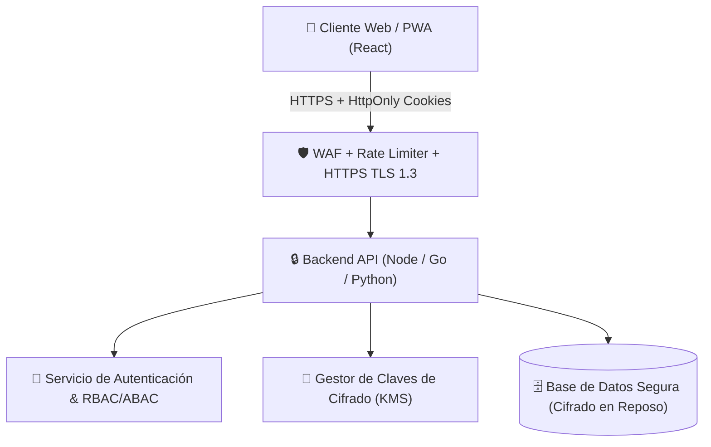

# 🛡️ SECURITY ROADMAP: Nuestro Hogar
## Requisitos Obligatorios de Seguridad para el Paso a Producción

> **Estado del Proyecto:** MVP Local (Single Page Application con almacenamiento en `localStorage`).  
> **Propósito de este documento:** Detallar la arquitectura técnica, controles criptográficos y salvaguardas de backend indispensables antes de desplegar "Nuestro Hogar" en un entorno accesible públicamente o con datos reales sensibles.

---

## 1. Resumen Ejecutivo de la Arquitectura Objetivo

Actualmente, "Nuestro Hogar" opera como una aplicación web del lado del cliente (frontend-only). Toda la lógica de control de acceso (roles de adultos vs. niños, privacidad de finanzas, salud y pareja) reside en la memoria de React y en el almacenamiento local del navegador (`localStorage`).

Para una versión en **producción**, la aplicación debe transicionar hacia una arquitectura **Cliente-Servidor Segura con Confianza Cero (Zero-Trust Backend)**, donde:
- El navegador web **NUNCA** es considerado un entorno de confianza.
- Ninguna regla de autorización depende exclusivamente de la interfaz de usuario.
- Todos los datos son validados, autenticados, autorizados y encriptados en el servidor.

---

## 2. Autenticación y Gestión de Sesiones

### 2.1 Autenticación de Adultos (Mamá y Papá)
- **Credenciales Robustas:** Hashing de contraseñas mediante **Argon2id** o **bcrypt** (factor de costo $\ge 12$).
- **Autenticación Multifactor (MFA):** Soporte obligatorio o altamente recomendado para los adultos mediante TOTP (Google Authenticator, Authy) o WebAuthn/FIDO2 (Passkeys / Biometría).
- **Tokens de Sesión:**
  - Emisión de identificadores de sesión opacos o JWTs de corta duración (máximo 15 minutos).
  - Almacenamiento **ESTRICTO** en cookies con flags:
    - `HttpOnly`: Impide lectura desde JavaScript (inmune a ataques XSS).
    - `Secure`: Solo se transmiten sobre HTTPS.
    - `SameSite=Lax` o `SameSite=Strict`: Previene falsificación de petición en sitios cruzados (CSRF).
  - Rotación automática de Refresh Tokens con detección de reuso y revocación inmediata.
- **PIN Familiar Rápido:** Para alternar entre perfiles adultos en el mismo dispositivo doméstico, implementar un PIN hash de 4-6 dígitos verificado contra el servidor.

### 2.2 Perfiles Infantiles
- Los perfiles infantiles no requieren credenciales complejas, pero su cambio de contexto debe ser validado por la sesión del adulto custodio.
- El servidor debe rechazar cualquier token de sesión infantil que intente consultar endpoints de adultos.

---

## 3. Control de Acceso y Autorización (RBAC & ABAC)

### 3.1 Modelo de Roles
- **Roles del Sistema:**
  - `SuperAdmin` (Administrador de plataforma / DevOps).
  - `FamilyAdult` (Adulto del hogar con derechos administrativos completos sobre la familia).
  - `FamilyChild` (Niño del hogar con permisos de solo lectura para sus rutinas y canje de premios).
- **Atributos de Acceso (ABAC):**
  - `familyId`: Cada consulta a la base de datos debe filtrar obligatoriamente por el `familyId` del usuario autenticado (Aislamiento Multi-Tenant).
  - `ownerId`: En registros de finanzas personales (`Mi Organización`) o check-ins privados de pareja, solo el adulto propietario puede leer o modificar el registro.

### 3.2 Matriz de Autorización en Endpoints de API

| Recurso / Módulo | Perfil Adulto (Mamá / Papá) | Perfil Infantil (Niños) | Validación Servidor |
| :--- | :---: | :---: | :--- |
| **Finanzas Familiares** | Lectura / Escritura | 🚫 Denegado (403) | `role === 'adult' && familyId === req.familyId` |
| **Finanzas Personales** | Solo el adulto propietario | 🚫 Denegado (403) | `role === 'adult' && ownerId === req.userId` |
| **Salud y Medicamentos** | Lectura / Escritura | 🚫 Denegado (403) | `role === 'adult' && familyId === req.familyId` |
| **Pareja y Cuqui Time** | Solo los 2 adultos | 🚫 Denegado (403) | `role === 'adult' && familyId === req.familyId` |
| **Check-in Privado** | Solo el creador | 🚫 Denegado (403) | `ownerId === req.userId` |
| **Hábitos y Recompensas** | Gestión total | Lectura / Completar propio | Verificación de pertenencia a la familia |
| **Configuración Global** | Lectura / Escritura | 🚫 Denegado (403) | `role === 'adult'` |

---

## 4. Protección y Cifrado de Datos

### 4.1 Cifrado en Tránsito
- Forzar **HTTPS** con **TLS 1.3** exclusivamente.
- Configurar cabecera HTTP **HSTS (HTTP Strict Transport Security)** con `max-age=63072000; includeSubDomains; preload`.
- Deshabilitar suites criptográficas obsoletas (TLS 1.0, 1.1 y 1.2 débiles).

### 4.2 Cifrado en Reposo (Database & Files)
- Base de datos relacional (PostgreSQL / MySQL) con cifrado transparente de datos (**TDE** / AES-256).
- **Cifrado a Nivel de Columna / Campo (Envelope Encryption):**
  Para los campos más sensibles, aplicar cifrado a nivel de aplicación antes de persistir en base de datos:
  - Prescripciones médicas, dosis y notas de salud infantil.
  - Notas de intimidad y sesiones de Cuqui Time.
  - Montos y descripciones de deudas e ingresos personales.
  - Claves maestras gestionadas mediante KMS de nube (AWS KMS, GCP Cloud KMS o HashiCorp Vault).

---

## 5. Validación Server-Side y Prevención de Inyección

- **Validación Estricta de Esquemas (Zod / Joi):**
  - Todo payload entrante debe validarse contra un esquema rígido.
  - Rechazar claves desconocidas (`stripUnknown` / `.strict()`).
  - Límites de longitud máxima en cadenas de texto para evitar ataques DoS por agotamiento de memoria.
- **Prevención de Inyección SQL / NoSQL:**
  - Uso exclusivo de ORM/Query Builders parametrizados (Prisma, Drizzle, TypeORM).
  - Prohibir consultas concatenadas en texto plano.
- **Prevención de XSS:**
  - Configurar cabeceras de seguridad HTTP:
    - `Content-Security-Policy (CSP)`: `default-src 'self'; script-src 'self'; object-src 'none'; frame-ancestors 'none';`
    - `X-Content-Type-Options: nosniff`
    - `X-Frame-Options: DENY`
    - `Referrer-Policy: strict-origin-when-cross-origin`
  - Sanitización HTML en cualquier campo que permita texto enriquecido con DOMPurify.

---

## 6. Respaldos, Exportación y Recuperación Segura

- **Exportación Segura:**
  - Los archivos de respaldo `.json` deben estar protegidos por contraseña opcional mediante derivación de claves PBKDF2 / Argon2 + AES-GCM-256.
- **Validación de Importación:**
  - Cuarentena de archivos importados en memoria.
  - Validación de esquema completa antes de insertar en base de datos transaccional (con `ROLLBACK` en caso de anomalía).
  - Prevención de desbordamiento de cuota de almacenamiento.
- **Recuperación de Cuentas:**
  - Flujo de restablecimiento de contraseña mediante enlaces de un solo uso con caducidad corta (15 minutos).
  - Notificación inmediata por correo electrónico ante cambios de credenciales o accesos desde dispositivos nuevos.

---

## 7. Monitoreo, Auditoría y Cumplimiento Normativo

- **Registro de Auditoría Inmutable (Audit Log):**
  - Registrar eventos críticos: inicio de sesión, cambio de perfil, modificación de dosis de medicamentos, visualización de finanzas personales, exportación de datos familiares.
  - Logs sin información sensible en texto claro (pseudonimización de IPs y sin volcado de credenciales ni notas íntimas).
- **Protección contra Abuso y Fuerza Bruta:**
  - Rate Limiting en endpoints sensibles (máximo 5 intentos fallidos de login por IP y cuenta cada 15 minutos).
  - Bloqueo de IPs sospechosas mediante WAF (Cloudflare / AWS WAF).
- **Derecho al Olvido y Eliminación de Datos (GDPR / Leyes Locales de Protección de Datos):**
  - Implementar botón de "Eliminar Familia y Todos sus Datos" que ejecute borrado criptográfico seguro de todas las tablas relacionadas y copias de seguridad activas.

---

## 8. Cronograma de Implementación Recomendado

| Fase | Alcance | Tecnologías Sugeridas |
| :---: | :--- | :--- |
| **Fase 1: API & Auth** | Backend REST/GraphQL, Autenticación HttpOnly cookies, RBAC base | Node.js (NestJS / Express) + Prisma + PostgreSQL |
| **Fase 2: Multi-Tenancy** | Aislamiento por familia, validación server-side Zod, tests de integración | Zod, Vitest, PostgreSQL Row-Level Security (RLS) |
| **Fase 3: Cifrado Sensible** | Encriptación en reposo de datos médicos, íntimos y financieros | AES-256-GCM, Cloud KMS |
| **Fase 4: Infraestructura** | Despliegue en contenedor con HTTPS forzado, WAF, CI/CD seguro | Docker, Caddy / Nginx, Cloudflare |
| **Fase 5: Auditoría Externa** | Test de penetración (pentesting) por terceros antes del lanzamiento | OWASP Testing Guide v4 |
